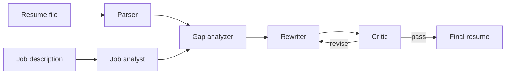

# Multi-Agent Resume Optimizer

Give it a resume and a job description. It returns a tailored resume that matches the job better, and it never adds a fact that isn't already in your resume.

> **Status:** work in progress. Week 1 of 10 (foundations). Live demo, eval results, and demo video will be added at launch.

## What it does

1. **Parser** turns a PDF or DOCX resume into structured data.
2. **Job analyst** extracts required skills, keywords, and seniority from the job description.
3. **Gap analyzer** compares the two and reports what matches, what is weak, and what is missing.
4. **Rewriter** rephrases and reorders resume bullets to close the gaps, using only facts already in the resume.
5. **Critic** reviews the rewrite for invented claims, ATS-unfriendly formatting, and keyword stuffing, and sends it back to the rewriter if it fails.

**The one rule:** the rewriter may rephrase, reorder, and tighten. It may never add a skill, tool, metric, title, or date that isn't in the source resume.

## Architecture

This is a fixed workflow with one bounded loop, not a free-roaming agent. The steps are known ahead of time, and the agents have no tools, so there is nothing for a prompt injection to act on.



Agents never copy text between each other. They point at it by id. Code assigns ids after each agent returns (`exp0-b1`, `skill3`, `must2`, `rw0`), and code verifies every id an LLM later cites. That check is what makes the no-fabrication rule enforceable.

## Tech stack

- **Backend:** Python, Pydantic, FastAPI, LangGraph
- **LLM:** Anthropic Claude (behind one wrapper, so the provider can be swapped)
- **Frontend:** Next.js (planned)
- **Data:** Postgres (planned)
- **Infra:** Docker, GitHub Actions, Vercel, Render (planned)

## Project structure

```
backend/
  schemas/        Pydantic models, id assignment, id validation
  agents/         one module per agent (planned)
  graph/          LangGraph orchestration (planned)
frontend/         Next.js app (planned)
evals/            eval harness and reports (planned)
data/eval/        test set of resume and job description pairs
docs/             decisions, design notes
tests/            pytest suite
```

## Run it locally

```bash
git clone https://github.com/<your-username>/multiagent-resume-optimizer.git
cd multiagent-resume-optimizer

python -m venv .venv
source .venv/bin/activate          # Windows: .venv\Scripts\activate
pip install -r requirements.txt

cp .env.example .env               # then add your API key to .env
pytest
```

## Privacy

Don't commit real resumes. The test set uses only synthetic and self-owned resumes. Never commit `.env` or API keys.
